# Credit Risk Scoring, Early Warning & Fraud Detection

> **Portfolio prototype, not a production lending system.** Built on public data (Kaggle *Home Credit Default Risk* and *PaySim*) to demonstrate the end-to-end workflow a fintech lender needs: score applicants (including thin-file customers), set cut-offs and limits, catch deteriorating accounts early, flag fraud within an ops budget, serve decisions through an API, and monitor models after launch.

**Author:** Favour Eneze Odiyo · [LinkedIn](https://linkedin.com/in/favour-odiyo) · [GitHub](https://github.com/enezefavourr)

---

## The business problems and what this repo answers

| Business question | What I built | Where |
|---|---|---|
| Who should we lend to, and how much? | WoE/IV logistic **scorecard** (champion) vs Random Forest and **XGBoost** (challengers); PD → risk grades A–E → decision, pricing tier and credit limit | `src/credit/` |
| Can we score customers with **no bureau history**? | Behavioural repayment features from previous loans; Gini reported separately for the thin-file segment | `features.py`, `reports/segment_performance.csv` |
| What cut-off balances approvals against losses? | Cut-off strategy table: approval rate, bad rate, defaults avoided and **expected loss (PD × LGD × EAD)** at each score | `reports/cutoff_strategy.csv` |
| Why was this applicant declined? | Points-based **reason codes** from the scorecard; **SHAP** drivers from XGBoost | `scorecard.py`, `reports/figures/shap_*` |
| How is the book performing? | **DPD buckets, PAR30/PAR90, roll-rate matrix, vintage curves** | `dpd_ews.py` |
| Which accounts will go bad next? | **Behavioural score + Early Warning System** (Red/Amber/Green), trained on five pooled snapshots and tested **out-of-time** on a later one | `dpd_ews.py` |
| Is someone stealing from wallets? | **Rules + Isolation Forest + XGBoost hybrid** with network (mule) features, thresholds tuned to an **ops review budget** | `src/fraud/` |
| How do products use the models? | **FastAPI** service (`/score`, `/score/batch`, `/fraud/score`) and an overnight **batch scorer** | `api/`, `src/batch_score.py` |
| Is the model still working? | **PSI, CSI, Gini/KS, calibration**, missing-data checks, retraining triggers, auto-written **health report** | `src/monitoring/` |
| How do leaders see it? | **Power BI** dashboard: 5 pages, data model and DAX measures | `powerbi/` |

## Architecture

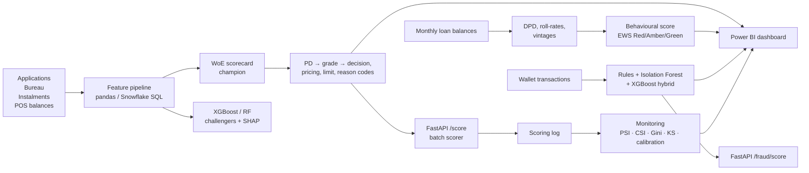

## Results (real data)

> Filled in from the full Kaggle run. See `reports/` for every table.

| Credit model (validation) | AUC | Gini | KS |
|---|---|---|---|
| Scorecard (LR, WoE) | _TBD_ | _TBD_ | _TBD_ |
| Random Forest | _TBD_ | _TBD_ | _TBD_ |
| XGBoost | _TBD_ | _TBD_ | _TBD_ |

- **Recommended cut-off:** _TBD_
- **Early warning (out-of-time):** _TBD_
- **Fraud hybrid at the ops budget:** _TBD_

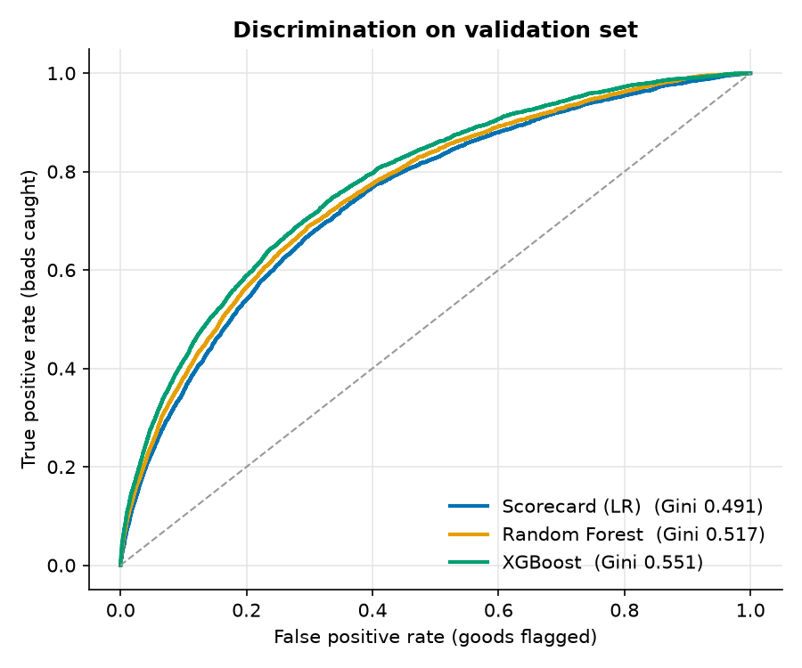
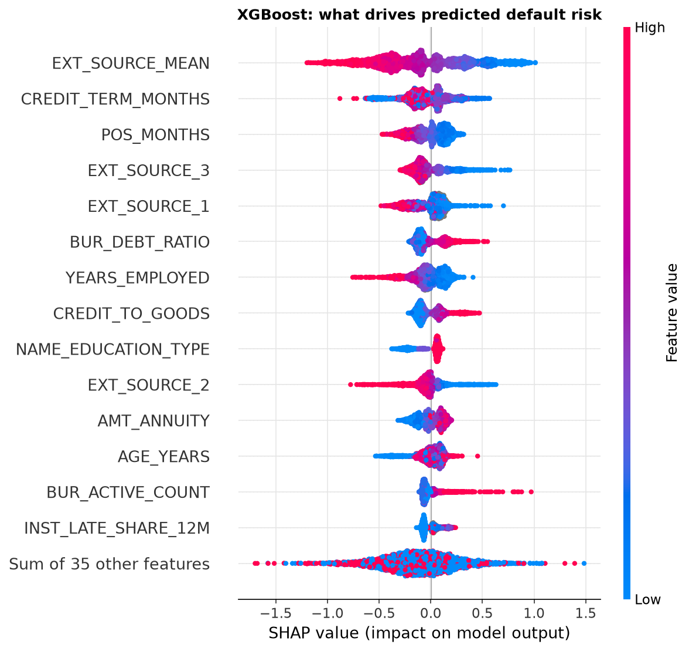
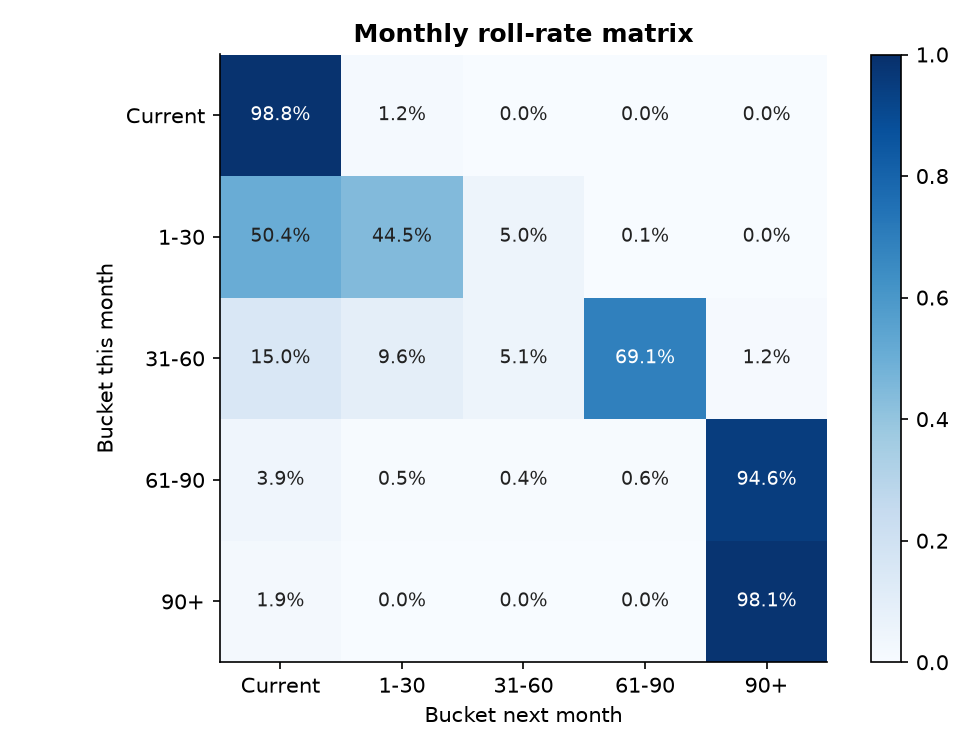
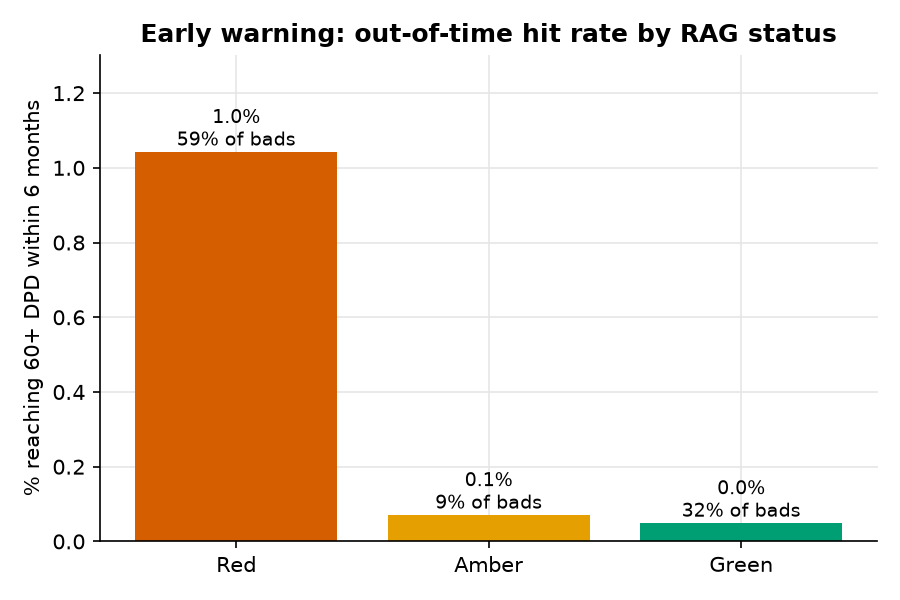
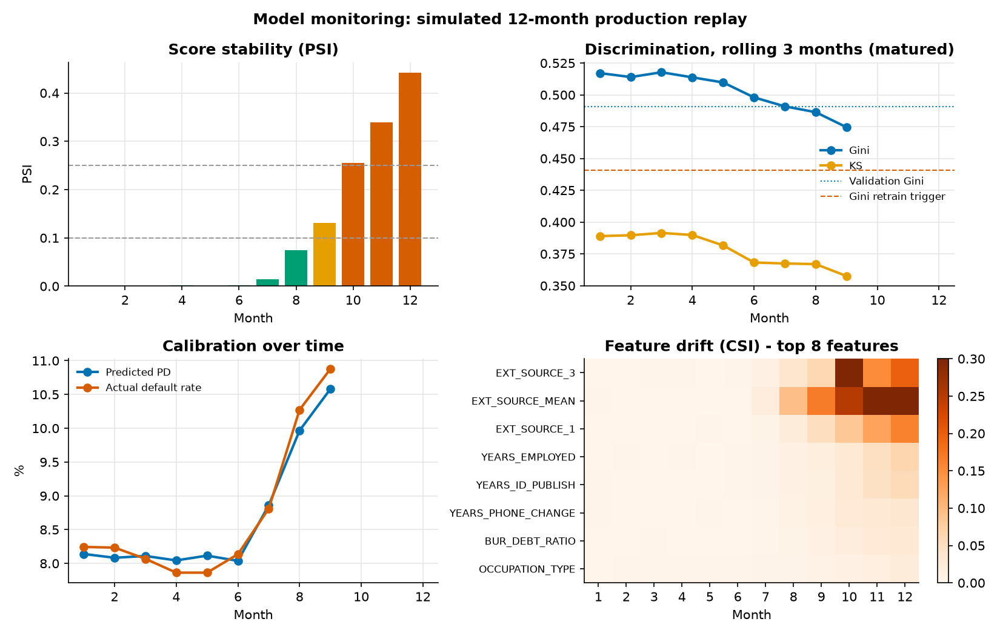
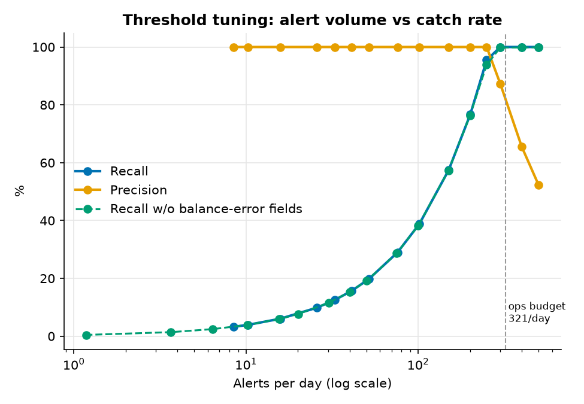

## Power BI dashboard

Five pages built on the pipeline outputs (`powerbi/data/`, data model and DAX in `powerbi/README.md`, report file `credit-risk-ews.pbix`).

| Portfolio overview | Credit model performance |
|---|---|
| 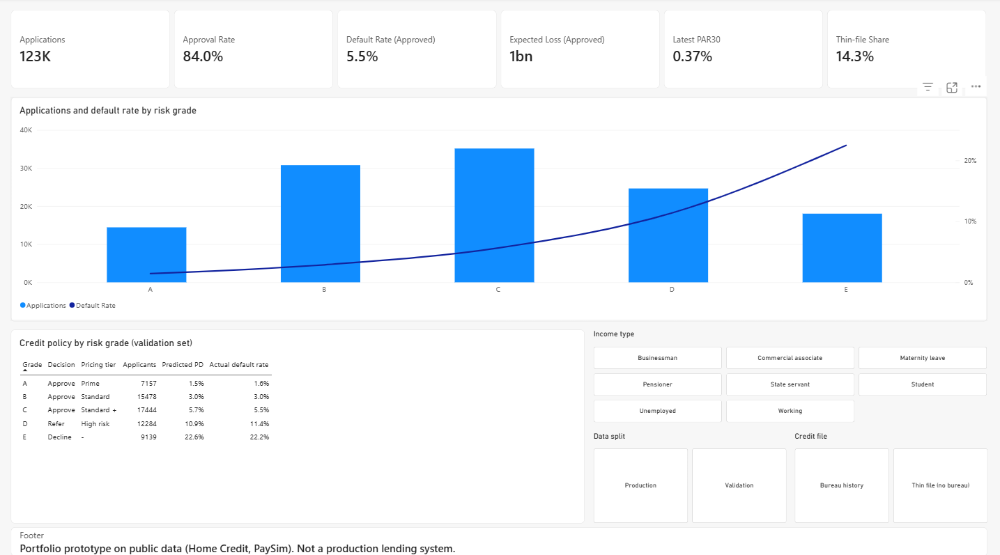 | 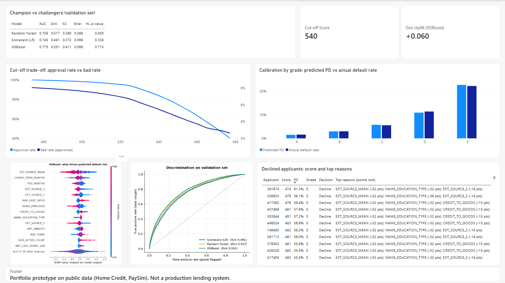 |
| **Delinquency & early warning** | **Model monitoring** |
| 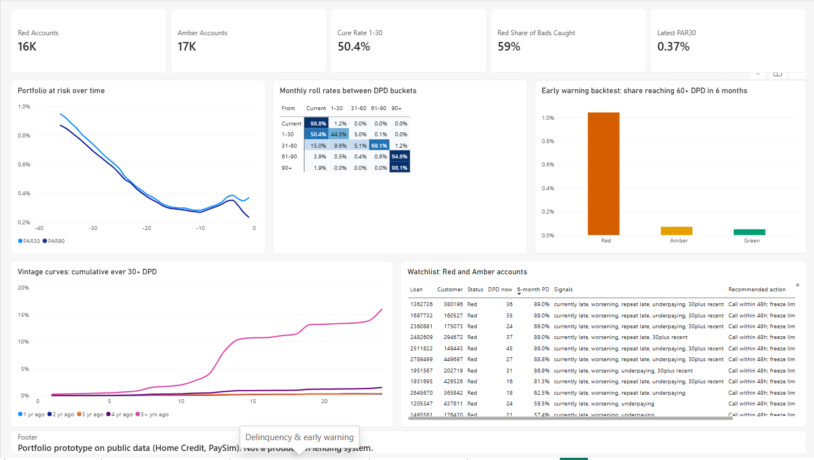 | 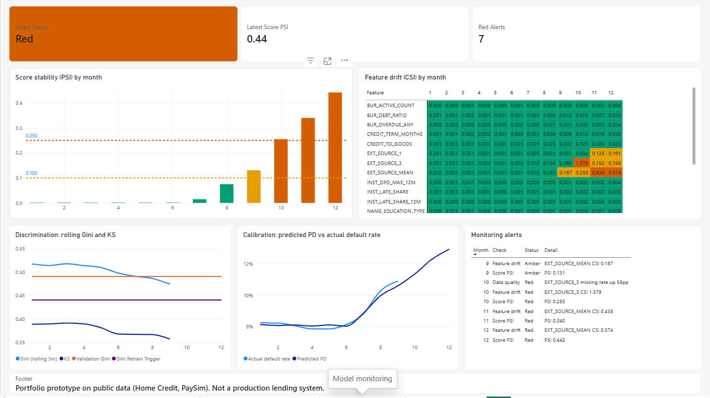 |
| **Fraud operations** | |
| 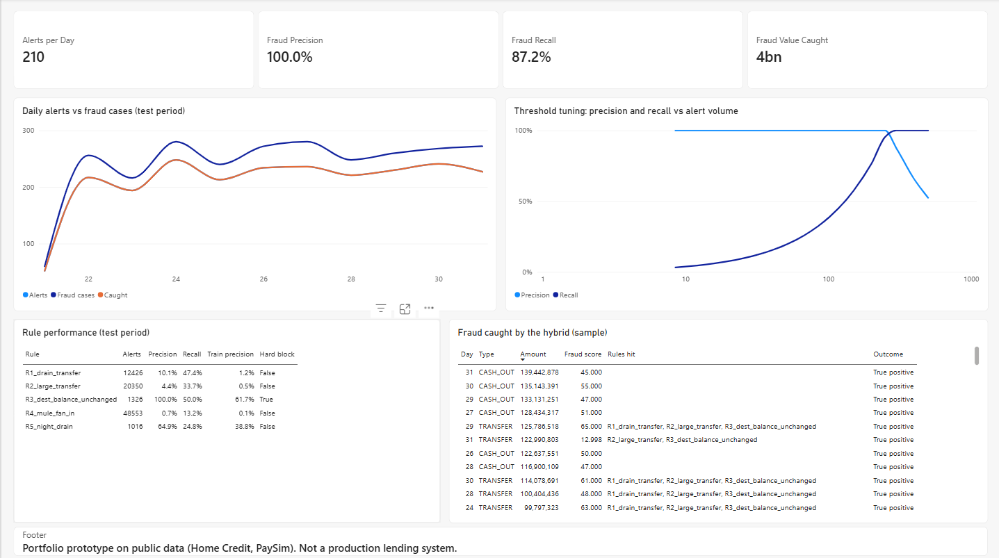 | |

## Design decisions (and why)

**Credit**
- **Scorecard as champion, XGBoost as challenger.** A points-based scorecard can be explained to a credit committee and a regulator line by line, and it gives every declined applicant clear reasons. XGBoost runs alongside it; if it consistently adds Gini, it has to earn promotion with SHAP-based reason codes.
- **Monotonic WoE bins.** Bins are merged until risk moves in one direction only (e.g. risk never rises and then falls as income increases), so the points table always makes sense to a human.
- **No class re-weighting.** Re-weighting distorts probabilities. PDs here drive pricing and expected loss, so they must stay calibrated (checked with calibration curves and a Hosmer-Lemeshow test). Class imbalance is handled where it matters: the cut-off.
- **Protected attribute excluded.** `CODE_GENDER` is never a model input.
- **Leakage control.** Only repayment history dated before the application is used; payments made after the decision date are treated as unpaid.

**Early warning**
- **Out-of-time validation.** The behavioural score is trained on five pooled snapshots (25 to 13 months back) and tested on a snapshot 7 months back; no training outcome window overlaps the test window. Pooling matters because rolling to 60+ DPD is rare (about 1 in 800 accounts per 6 months).
- **Monotonic gradient boosting.** DPD signals are heavy-tailed and interact, so a boosted model beats a linear one; monotonic constraints guarantee that more days late or more underpayment can never lower the risk score.
- **Readable signals plus a score.** Collections teams get both: plain rules ("worsening", "repeat late", "underpaying") and a probability that ranks who to call first.

**Fraud**
- **Rules earn hard-block status on training data only.** A rule auto-alerts only if its precision was at least 50% in the training period. Noisy rules still help, as inputs to the model.
- **Thresholds set by ops capacity.** Review capacity is sized at 1.2× the average daily fraud count; the ML threshold is chosen on the training period so total alerts fit that capacity, then checked on a later, unseen period.
- **Artifact check.** A second XGBoost is trained without PaySim's balance-reconciliation fields, to show how much of the score depends on a quirk real ledgers would not expose.
- **Network features computed from the past only**: fan-in to a destination account and receive-then-send behaviour (mule patterns).

**Monitoring**
- **Outcome lag is respected.** Stability (PSI/CSI, missing rates) is checked every month; Gini, KS and calibration only once defaults have had 3 months to show.
- **Rolling 3-month Gini.** A single small month is too noisy to trigger a retrain.
- **Data-quality checks on every model input**, not just scorecard features, so a failed feed is caught even when it only affects the challenger.

## Run it

```bash
python -m venv .venv && source .venv/bin/activate      # Windows: .venv\Scripts\activate
pip install -r requirements.txt

# Option A: quick demo on synthetic data with the same schema (about 1 minute)
python run_all.py --sample

# Option B: real data. Put these Kaggle files in data/raw/:
#   application_train.csv, bureau.csv, installments_payments.csv, POS_CASH_balance.csv
#   and the PaySim CSV (PS_*log*.csv or paysim.csv)
python run_all.py

pytest -q                               # API tests
uvicorn api.main:app --reload           # API docs at http://127.0.0.1:8000/docs
python -m src.batch_score --input data/raw/application_train.csv --output scored.csv
```

### Example `/score` response

```json
{
  "applicant_id": 900002,
  "model_version": "pd_app_v1.0",
  "score": 504,
  "pd_12m": 0.366,
  "risk_grade": "E",
  "decision": "Decline",
  "recommended_limit": 0.0,
  "expected_loss": 98816.38,
  "thin_file": true,
  "reason_codes": ["EXT_SOURCE_MEAN (-46 pts)", "INST_DPD_MEAN (-21 pts)", "AGE_YEARS (-14 pts)"],
  "challenger_pd_xgboost": 0.472,
  "challenger_top_drivers": ["EXT_SOURCE_MEAN (+0.62 log-odds)", "AGE_YEARS (+0.37 log-odds)"]
}
```

## Limitations (being honest)

- **Public data, not a live book.** Home Credit has no calendar dates, so vintages use relative cohorts and production months are simulated by replaying a held-out set with injected drift. The method transfers; the numbers do not.
- **PaySim is simulated.** Its balance fields make fraud unusually easy to separate, so near-perfect fraud scores are a dataset artifact. The value shown is the approach: rules + ML, leakage-safe features and budget-based thresholds.
- **Illustrative policy.** LGD = 45%, grade bands, pricing tiers and limit multiples are assumptions a credit committee would set.
- **Not covered here:** propensity / cross-sell models and A/B uplift testing.

## Repository layout

```
src/credit/        features.py, scorecard.py (WoE/IV engine), train.py, dpd_ews.py, preprocess.py
src/fraud/         train_fraud.py
src/monitoring/    monitor.py
src/common/        config.py, metrics.py (Gini, KS, PSI, HL), plotting.py
src/batch_score.py overnight scoring job
api/               FastAPI service
sql/               Snowflake versions of the behavioural features and roll-rates
powerbi/           data model, DAX measures, page designs, exported tables (data/)
reports/           metrics tables, figures, model_health_report.md
artifacts/         model_card.json (+ model files, rebuilt by the pipeline)
tests/             API tests
```

## Glossary

| Term | Meaning |
|---|---|
| **PD / LGD / EAD** | Probability of default / share of exposure lost if default happens / amount owed at default. Expected loss = PD × LGD × EAD |
| **DPD** | Days past due |
| **PAR30 / PAR90** | Portfolio at risk: share of active loans more than 30 / 90 days overdue |
| **NPA / NPL** | Non-performing asset / loan, typically 90+ DPD |
| **Roll rate** | Probability an account moves from one DPD bucket to another next month |
| **Vintage curve** | Cumulative bad rate by months on book for loans originated in the same period |
| **WoE / IV** | Weight of Evidence (bin-level risk on a log-odds scale) / Information Value (a feature's predictive power) |
| **Gini / KS** | Rank-ordering power (2·AUC − 1) / maximum separation between good and bad score distributions |
| **PSI / CSI** | Population / Characteristic Stability Index: how far the score / a feature has drifted from training |
